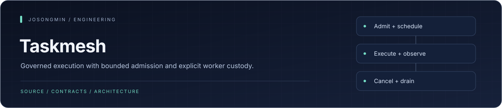
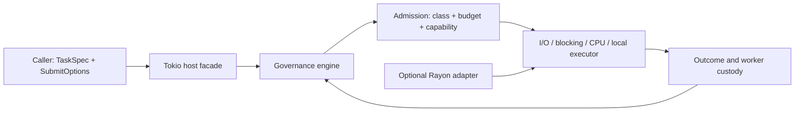

<p align="center"></p>

# Taskmesh

A Rust execution control plane for asynchronous I/O, blocking work, CPU tasks, and local-runtime execution. Taskmesh makes class policy, resource admission, executor topology, and worker custody explicit contracts.

The runtime distinguishes **a caller receiving a response**, **a worker stopping**, and **capacity becoming available**. That distinction is central to cancellation, deadlines, and safe shutdown.

## Engineering highlights

| Mechanism | Engineering purpose |
| :--- | :--- |
| **One admission decision** | Class inflight limits, resource budgets, and capability-pool capacity are decided together; competing paths do not gain hidden unbounded queues. |
| **Explicit substrates** | Task specifications declare execution substrate. A mismatched run path rejects rather than silently selecting a different executor. |
| **Bounded fairness** | Class policy declares queue depth and fairness discipline; incompatible tier policies are rejected during construction. |
| **Capacity custody** | Started synchronous work can remain charged after its caller is cancelled or times out, until the worker actually exits. |
| **Validated topology** | Executor worker counts and physical domains are validated and frozen for dispatch and runtime observation. |
| **Declared task lineage** | Child/root identity and explicitly declared nested waits support attribution and cycle rejection without inferring undeclared waits. |

## Architecture



## Development

Add the facade from this repository; it is not assumed to be published on crates.io:

```toml
[dependencies]
taskmesh = { git = "https://github.com/josongmin/quanta-taskmesh.git" }
```

The public builder and a complete usage example are in [the facade](crates/taskmesh/src/lib.rs). Use `run_io`, `run_blocking`, `run_cpu`, or `run_local` for the declared substrate.

```sh
just --list
just dev
just verify-macos-ci
```

Recipes and external-tool requirements are owned by [Justfile](Justfile). Mutation campaigns are explicit opt-in work, not part of a routine README or local verification pass.

## Source map

| Area | Owner |
| :--- | :--- |
| Public builder, driving runtime, cancellation adapter | [taskmesh](crates/taskmesh/) |
| Product-neutral vocabulary and ports | [taskmesh-contract](crates/taskmesh-contract/) |
| Admission, fairness, and governance state | [taskmesh-engine](crates/taskmesh-engine/) |
| CPU executor integration | [taskmesh-rayon](crates/taskmesh-rayon/) |
| Benchmarks and policy inventory | [Benchmark crate](crates/taskmesh-bench/) · [Gate tools](tools/gates/) |

## Documentation

- [Library specification](docs/taskmesh-library-spec.md)
- [External interface and run-path semantics](docs/taskmesh-external-interface.md)
- [Accepted architecture decisions](docs/adr/README.md)
- [Remaining work](docs/remaining-work.md)
- [Source-bound evidence inventory](docs/evidence/sep25/README.md)

## Scope and verification

A single `run_*` call executes only the first declared stage. Later stages, branch execution, and reduction remain caller/adapter responsibilities. Declaring a reduce policy validates its shape; it does not make the host a workflow executor.

Cancellation of a waiting caller does not forcibly terminate already-started synchronous work. Deadline support is policy-dependent; unsupported deadlines reject. `checkpoint_policy` is metadata for host hook points, not an engine-enforced checkpoint implementation.

Source-local tests, benchmark completion, clean-source qualification, consumer adoption, and deployment are separate results. The commands above do not assert that those scopes have passed on the current revision.
