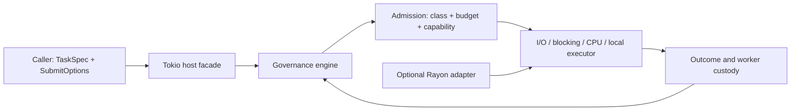

<p align="center"></p>

# Taskmesh

A Rust execution control plane for asynchronous I/O, blocking work, CPU tasks, and local-runtime execution. Taskmesh makes class policy, resource admission, executor topology, and worker custody explicit contracts.

The runtime distinguishes **a caller receiving a response**, **a worker stopping**, and **capacity becoming available**. That distinction is central to cancellation, deadlines, and safe shutdown.

## Engineering highlights

| Mechanism | Engineering purpose |
| :--- | :--- |
| **One admission decision** | Class inflight limits, resource budgets, and capability-pool capacity are decided together; competing paths do not gain hidden unbounded queues. |
| **Explicit substrates** | Task specifications declare execution substrate. A mismatched run path rejects rather than silently selecting a different executor. |
| **Bounded fairness** | Class policy declares queue depth and fairness discipline; incompatible tier policies are rejected during construction. |
| **Capacity custody** | Started synchronous work can remain charged after its caller is cancelled or times out, until the worker actually exits. |
| **Validated topology** | Executor worker counts and physical domains are validated and frozen for dispatch and runtime observation. |
| **Declared task lineage** | Child/root identity and explicitly declared nested waits support attribution and cycle rejection without inferring undeclared waits. |

## Architecture



## Usage examples

<details>
<summary>Configuration, execution, cancellation, and integration examples</summary>

### Quick example

```rust
use taskmesh::{Builder, ClassPolicy, ResourceBudget, Runtime, TaskClass, TaskSpec, TopologyConfig};

#[tokio::main(flavor = "current_thread")]
async fn main() {
    let runtime = Builder::new()
        .topology(
            TopologyConfig::new()
                .cpu_auto()
                .reserve_cores(1)
                .min_workers(1)
                .max_workers(8)
                .blocking_threads(8),
        )
        .resources(ResourceBudget::new().cpu_units(64).memory_units(256))
        .class_policy(
            TaskClass::new("retrieval"),
            ClassPolicy::new()
                .max_inflight(32)
                .max_queue_depth(128)
                .cpu_units(1)
                .memory_units(2),
        )
        .build()
        .expect("runtime must build");

    let spec = TaskSpec::blocking(TaskClass::new("retrieval")).operation("search:repo:123");
    let out: String = runtime
        .run_blocking(spec, || Ok::<_, std::convert::Infallible>("ok".to_string()))
        .await
        .expect("governor and task must succeed");

    assert_eq!(out, "ok");
}
```

Consumers depend on the `taskmesh` facade. The current workspace manifest is `0.3.0`; registry publication, compatibility approval, exact-source release qualification, and consumer activation are separate decisions. See the [changelog](CHANGELOG.md) and [release checklist](docs/release-checklist.md) before selecting a revision.

### Runtime configuration

Topology controls worker capabilities and resource capacity. Class policy controls semantic admission behavior, queueing, fairness, budgets, and supported cancellation/deadline behavior.

```rust
use taskmesh::{
    Builder, CancellationPolicy, ClassPolicy, FairnessPolicy, ResourceBudget, TaskClass,
    TopologyConfig,
};

let runtime = Builder::new()
    // Worker topology: capability pools only; no engine-specific pools.
    .topology(
        TopologyConfig::new()
            .cpu_auto()            // or .cpu_fixed(n)
            .reserve_cores(1)
            .min_workers(1)
            .max_workers(8)
            .blocking_threads(8)
            .local_runtime_slots(1),
    )
    // Global resource budget in accounting units.
    .resources(
        ResourceBudget::new()
            .cpu_units(64)
            .memory_units(256)
            .per_request_cpu_units(4)
            .per_request_memory_units(16),
    )
    // Class semantic policy; the caller owns its taxonomy.
    .class_policy(
        TaskClass::new("retrieval"),
        ClassPolicy::new()
            .max_inflight(32)
            .max_queue_depth(128)
            .cpu_units(1)
            .memory_units(2)
            .fairness(FairnessPolicy::DeficitRoundRobin { quantum: 4 })
            // Mid-run cancellation and deadlines require this policy. The default
            // `PreSubmitOnly` class rejects deadlines with `DeadlineUnsupported`.
            .cancellation_policy(CancellationPolicy::CooperativeWithDeadline),
    )
    .build()
    .expect("policy must validate");
```

### Execute work through the matching path

```rust
use taskmesh::{Runtime, TaskClass, TaskSpec};

let class = TaskClass::new("retrieval");

// Async I/O path.
let spec = TaskSpec::io(class.clone()).operation("fetch:doc:42");
let body: String = runtime
    .run_io(spec, async { Ok::<_, std::io::Error>(load().await?) })
    .await?;

// Blocking path (spawn_blocking pool).
let spec = TaskSpec::blocking(class.clone()).operation("parse:blob");
let parsed: Doc = runtime
    .run_blocking(spec, || Ok::<_, ParseError>(parse_sync()))
    .await?;

// CPU path (shared CPU pool with the rayon feature).
let spec = TaskSpec::cpu(class.clone()).operation("rank:candidates");
let ranked: Vec<Hit> = runtime
    .run_cpu(spec, || Ok::<_, std::convert::Infallible>(rank()))
    .await?;

// Non-Send local path (LocalSet).
let spec = TaskSpec::local(class).operation("local:job");
let out = runtime.run_local(spec, async { Ok::<_, MyError>(do_local().await) }).await?;
```

Task hints must match the selected executor/substrate. Unknown classes are rejected rather than implicitly admitted. Bounded queues, queue expiry, and immediate shedding remain distinct outcomes.

Composite tasks declare their stages and reduction policy. The host `run_*` entry point executes only the first declared stage; declaration is not a promise that every stage is automatically scheduled.

```rust
use taskmesh::TaskStage;

let child = TaskSpec::cpu(TaskClass::new("retrieval"))
    .child_of("fetch:doc:42", "fetch:doc:42", TaskStage::new("rank"))
    .operation("rank:shard:3");
```

### Handle rejection and task errors separately

```rust
use taskmesh::{AdmissionVerdict, GovernorError, RunError};

match runtime.run_blocking(spec, job).await {
    Ok(value) => { /* success */ }

    // The governor rejected admission.
    Err(RunError::Governor(GovernorError::Rejected(verdict))) => match verdict {
        AdmissionVerdict::UnknownClass { class } => { /* Unregistered class; no default admission. */ }
        AdmissionVerdict::QueueFull { retry_after_ms }
        | AdmissionVerdict::CpuSaturated { retry_after_ms }
        | AdmissionVerdict::MemorySaturated { retry_after_ms }
        | AdmissionVerdict::SubstrateSaturated { retry_after_ms }   // Immediate shedding for a non-queueing class.
        | AdmissionVerdict::SubstratePoolTimedOut { retry_after_ms } // Expired after bounded waiting.
        | AdmissionVerdict::PermitAcquireTimedOut { retry_after_ms } => {
            // Back off for retry_after_ms before retrying.
            let _ = retry_after_ms;
        }
        AdmissionVerdict::SubstrateMismatch => { /* Run-path/hint mismatch. */ }
        AdmissionVerdict::MalformedTask => { /* Zero stages, mismatched stage class, or missing reduction. */ }
        other => { /* ClassDisabled, RuntimeUnavailable, and other verdicts. */ let _ = other; }
    },

    // The task itself failed.
    // A queued ticket ended before claim, for example by leak reaping; its reason is preserved.
    Err(RunError::Governor(GovernorError::TicketClaimTerminated { reason, .. })) => { let _ = reason; }

    // The task itself failed.
    Err(RunError::Task(e)) => { /* Caller error e. */ let _ = e; }

    Err(other) => { let _ = other; }
}
```

Admission failure, a ticket ending before claim, and an application-task error are different results. Preserve typed reasons and use the specified retry delay rather than converting a refusal into success.

### Observe the inventory

```rust
let snap = runtime.snapshot();
assert_eq!(snap.conservation_violation(), None); // inflight equals the phase sum; admitted equals inflight + terminated.
for (class, c) in &snap.classes {
    println!(
        "{class}: inflight={} (reserved={} accepted={} running={} cleanup={}) queued={} cpu_held={}",
        c.inflight, c.dispatch_reserved, c.accepted, c.running, c.cleanup_pending, c.queued, c.cpu_units_held,
    );
}
for (pool, usage) in &snap.capabilities {
    println!("pool {pool}: {}/{}", usage.in_use, usage.limit); // A zero limit is unbounded.
}
for s in &snap.substrates {
    println!("substrate {} kind={:?} pool={:?}", s.name, s.kind, s.capability_pool);
}
```

Inventory records bind semantic classes to executor capabilities and resource accounting. Conservation checks and gauges describe different parts of the state; a caller receiving a response does not prove that a worker ended or released capacity.

### Cancellation, timeouts, and drain

```rust
use std::time::Duration;
use taskmesh::{AdmissionVerdict, CancellationToken, GovernorError, RunError, SubmitOptions, TaskClass, TaskSpec};

let token = CancellationToken::new();
let opts = SubmitOptions::unbounded()
    .with_cancel(token.clone())                       // Cooperative cancellation before submission or during execution.
    .with_acquire_timeout(Duration::from_millis(50))  // Admission-queue wait bound.
    .with_deadline(Duration::from_secs(2));           // Execution deadline.

let spec = TaskSpec::io(TaskClass::new("retrieval")).operation("fetch");
let out = runtime.run_io_with(spec, opts, async { Ok::<_, MyError>(fetch().await) }).await;

match out {
    Err(RunError::Governor(GovernorError::Rejected(AdmissionVerdict::CancelledBeforeSubmit))) => {
        /* Cancelled before submission. */
    }
    Err(RunError::Governor(GovernorError::Cancelled)) => { /* Cooperative cancellation during execution. */ }
    Err(RunError::Governor(GovernorError::DeadlineExceeded)) => { /* Execution deadline exceeded. */ }
    Err(RunError::Governor(GovernorError::Rejected(
        AdmissionVerdict::PermitAcquireTimedOut { .. },
    ))) => { /* Admission-queue timeout. */ }
    Err(RunError::Governor(GovernorError::DeadlineUnsupported { class, policy })) => {
        /* Configuration error: class policy cannot enforce a deadline; rejected before the task starts. */
    }
    _ => {}
}
```

`SubmitOptions` distinguishes cancellation, admission acquisition timeout, and execution deadline. Class policy must support the requested behavior. A deadline on `PreSubmitOnly` is rejected as `DeadlineUnsupported` before work starts.

Started blocking work cannot be force-aborted by dropping a response future. The runtime retains custody and charges until execution actually ends. Treat response completion, worker termination, and capacity release as separate lifecycle events.

```rust
use std::time::Duration;

match runtime.drain(Duration::from_secs(30)).await {
    Ok(report) => {
        // All classes are empty; dropping the handle leaves no outstanding work.
        let _ = report.elapsed;
    }
    Err(not_drained) => {
        // Charged work remains; an already running blocking task cannot be aborted.
        // The runtime remains draining; a later drain continues waiting for the same work.
        for (class, left) in &not_drained.classes {
            eprintln!("{class}: inflight={} queued={}", left.inflight, left.queued);
        }
    }
}
```

A timed-out drain can leave charged work in a draining runtime. A later drain continues waiting for the outstanding work; it does not fabricate an empty inventory.

### Advanced integration

Use `taskmesh::ext` only when a consumer needs governor-level accounting, provenance, or adapter composition beyond the normal runtime facade.

```rust
use taskmesh::ext::{Governor, Provenance};

// (a) Direct governor access: memory reconciliation, leak reaping, and substrate inventory.
let gov: &Governor = runtime.governor();
let report = gov.reap_leaks();                       // Reap stale, unstarted permits in LeakDetecting classes.
// report.retained_active counts stale but active permits that were retained; stale does not mean dead.
// gov.reconcile_memory(permit_id, measured_bytes) -> ReconcileOutcome
// On EpochExhausted, release the permit rather than retrying it.
// gov.release_stage_memory(permit_id, units) -> StageReleaseOutcome; OnTaskCompletion returns PolicyForbids.
// gov.claim(ticket) -> ClaimOutcome::{Ready, Pending, Terminal(reason), Invalid}

// (b) Classification provenance remains auditable after submission.
// let prov: Option<Provenance> = gov.permit_provenance(permit_id); // source/reason
let _ = report;
```

Stale does not mean dead: leak reaping retains active work. Epoch exhaustion is terminal for that permit; do not loop on the same exhausted authority.

```rust
// Cargo.toml: taskmesh = { …, features = ["rayon"] }
use std::sync::Arc;
use taskmesh::ext::RayonCpuExecutor;

let topo = taskmesh::TopologyConfig::new().cpu_auto().reserve_cores(1);
let runtime = taskmesh::Builder::new()
    .topology(topo.clone())
    .cpu_executor(Arc::new(RayonCpuExecutor::try_from_topology(&topo)?))
    .class_policy(taskmesh::TaskClass::new("rank"), taskmesh::ClassPolicy::new().cpu_units(1))
    .build()?;
```

### Enforcement boundaries

- **Policy and governance:** semantic class policy is distinct from worker topology and substrate capacity.
- **Bounded competition:** queueing and non-queueing paths have explicit admission behavior; no unbounded alternate queue is implied.
- **Accounting lifetime:** the host owns execution/custody; dropping a caller future does not erase an active charge.
- **Memory policy:** resource units and reconciliation are semantic accounting contracts, not an OS RSS ceiling.
- **Deterministic composition:** parallel stages require explicit reduction; product-local classification is supplied by the consumer.
- **Compatibility:** API, wire, and behavioral changes need their own review, not only a compiler-compatible diff.

</details>

## Development

Add the facade from this repository; it is not assumed to be published on crates.io:

```toml
[dependencies]
taskmesh = { git = "https://github.com/josongmin/quanta-taskmesh.git" }
```

The public builder and a complete usage example are in [the facade](crates/taskmesh/src/lib.rs). Use `run_io`, `run_blocking`, `run_cpu`, or `run_local` for the declared substrate.

```sh
just --list
just dev
just verify-macos-ci
```

Recipes and external-tool requirements are owned by [Justfile](Justfile). Mutation campaigns are explicit opt-in work, not part of a routine README or local verification pass.

## Source map

| Area | Owner |
| :--- | :--- |
| Public builder, driving runtime, cancellation adapter | [taskmesh](crates/taskmesh/) |
| Product-neutral vocabulary and ports | [taskmesh-contract](crates/taskmesh-contract/) |
| Admission, fairness, and governance state | [taskmesh-engine](crates/taskmesh-engine/) |
| CPU executor integration | [taskmesh-rayon](crates/taskmesh-rayon/) |
| Benchmarks and policy inventory | [Benchmark crate](crates/taskmesh-bench/) · [Gate tools](tools/gates/) |

## Documentation

- [Library specification](docs/taskmesh-library-spec.md)
- [External interface and run-path semantics](docs/taskmesh-external-interface.md)
- [Accepted architecture decisions](docs/adr/README.md)
- [Remaining work](docs/remaining-work.md)
- [Source-bound evidence inventory](docs/evidence/sep25/README.md)

## Scope and verification

A single `run_*` call executes only the first declared stage. Later stages, branch execution, and reduction remain caller/adapter responsibilities. Declaring a reduce policy validates its shape; it does not make the host a workflow executor.

Cancellation of a waiting caller does not forcibly terminate already-started synchronous work. Deadline support is policy-dependent; unsupported deadlines reject. `checkpoint_policy` is metadata for host hook points, not an engine-enforced checkpoint implementation.

Source-local tests, benchmark completion, clean-source qualification, consumer adoption, and deployment are separate results. The commands above do not assert that those scopes have passed on the current revision.
